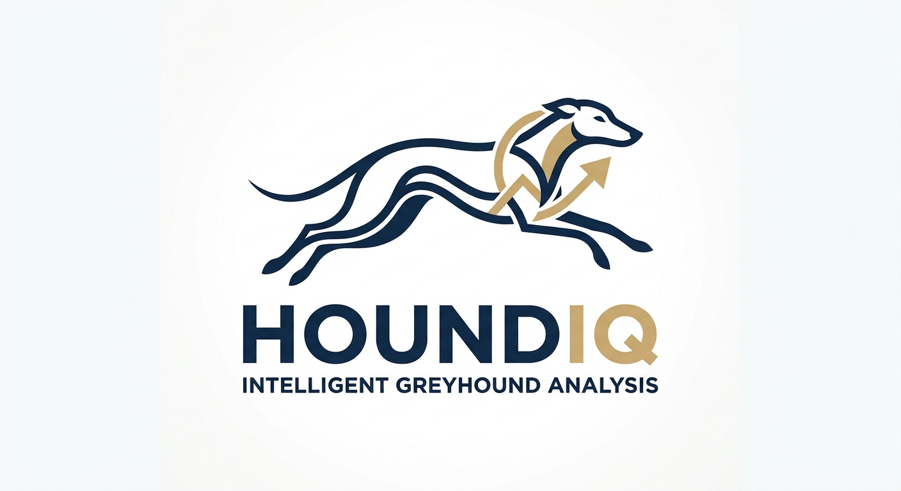

 <p align="center">
  
</p>

<p align="center">
  An AI-powered greyhound racing analysis application that combines historical structured data, statistical analysis, external research and LLM-based reasoning to produce evidence-based race assessments.
</p>

---

## Development Environment
HoundIQ uses **CPython 3.15.2**, managed through [pyenv](https://github.com/pyenv/pyenv).

### 1. Install pyenv
For Ubuntu, Debian and equivalent WSL distributions:

```bash
sudo apt update
sudo apt install -y curl git

curl -fsSL https://pyenv.run | bash
```

Configure pyenv in the shell and restart it:

```bash
~/.pyenv/bin/pyenv init --install
exec "$SHELL"
```

Install the Python build dependencies:

```bash
pyenv install-prerequisites
```

### 2. Install the project Python version
From the repository root:

```bash
pyenv install 3.15.2
pyenv local 3.15.2
```

`pyenv local` creates the `.python-version` file. This file is committed to the repository so every development environment can identify the required interpreter.

Verify the installation:

```bash
python --version
pyenv version
```

Expected Python version:

```text
Python 3.15.2
```

### 3. Change Python versions
To upgrade or select another version for the project:

```bash
pyenv install <version>
pyenv local <version>
```

This updates `.python-version` and changes the interpreter selected whenever you work inside the repository.

To temporarily use another installed version without modifying the project configuration:

```bash
pyenv shell <version>
```

Always verify the selected interpreter with `python --version` before running the application.

## Dependency Management
HoundIQ uses [uv](https://docs.astral.sh/uv/) to manage dependencies and create an isolated project environment.

### 1. Install uv
Install uv inside your Linux or WSL environment:

```bash
curl -LsSf https://astral.sh/uv/install.sh | sh
```

Verify the installation:

```bash
uv --version
```

### 2. Install project dependencies
From the repository root:

```bash
uv sync --locked
```

This creates the `.venv` directory and installs the exact dependency versions recorded in `uv.lock`, using the Python version declared in `.python-version`.

No manual virtual environment activation is required. Run project commands through uv:

```bash
uv run --locked <command>
```