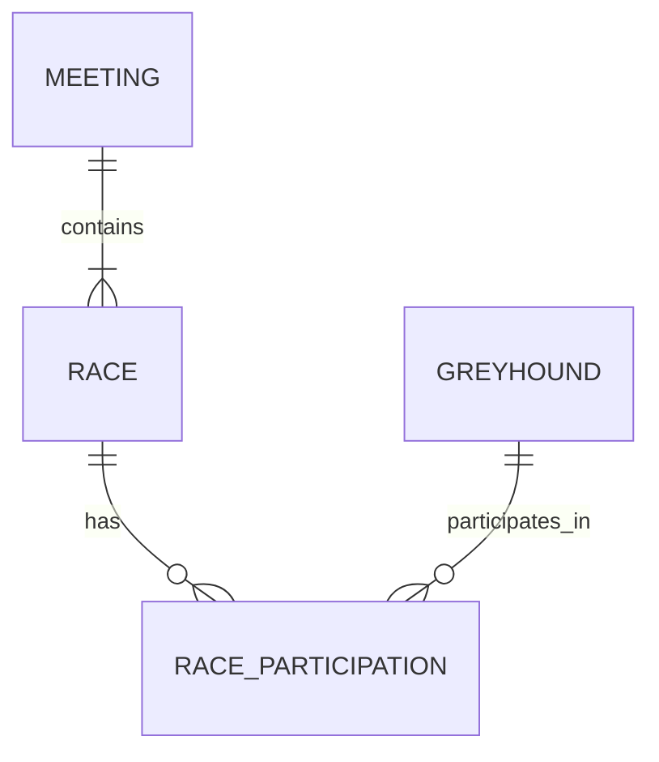

# Data Requirements & Domain Relationships

## 1. Purpose
Define what information HoundIQ needs from GBGB, which domain concepts it must represent and how they relate.

The goal is not to reproduce the scraper's JSON structure. Each decision should be driven by its relevance to race analysis and the potential value of the information.

## 2. Domain model

A **Race Participation** connects a greyhound to a race. It is necessary because information such as trap number, trainer and race performance belongs to a particular participation, not permanently to the greyhound or the race.

## 3. Data requirements

### Meeting
Represents a racing event held at a particular track and date.

**Accepted**
- `meetingId`: identifies the meeting.
- `meetingDate`: establishes when it took place.
- `trackName`: identifies the venue, allowing performances to be analysed in their track context.

**Rejected**
- No additional meeting fields are required from the currently documented source.

### Race
Represents an individual race within a meeting.

**Accepted**
- `raceId`: identifies the race.
- `raceNumber`: identifies its position within the meeting.
- `raceTime`: provides the race's time context.
- `raceClass`: allows comparisons between races of similar competitive levels.
- `raceDistance`: essential for comparing performances over comparable distances.
- `raceType`: distinguishes different race formats.
- `raceHandicap`: identifies handicap races.
- `raceGoing`: provides track-condition context for interpreting running times.
- `raceWinTime`: provides the historical winning time for the race.

**Rejected**
- `raceForecast`, `raceTricast`: describe betting forecasts and returns associated with completed races. They are not required to assess the participants' underlying performances.
- A separate `raceDate` attribute when it duplicates `meetingDate`. The source values must be checked before treating them as redundant.

**Deferred**
- `racePrizes`: prize money could help characterise the competitive level of a race, but its usefulness for the initial analysis has not been established.

### Greyhound
Represents an individual racing greyhound across its lifetime and racing history.

**Accepted**
- `dogId`: identifies the greyhound across datasets.
- `dogName`: identifies it in reports and human-readable analysis.
- `dogBorn`: allows age to be calculated at the date of each race.
- `dogSex`: potentially relevant biological context when comparing racing performances.
- `dogSire`: identifies its father and preserves pedigree information.
- `dogDam`: identifies its mother and preserves pedigree information.
- `dogOrigin`: retains information about its origin, which may provide additional breeding context.

Pedigree information is deliberately retained. A greyhound's lineage may reveal inherited traits or relevant bloodlines. Its predictive value must not be assumed, but discarding it at this stage would remove potentially useful information.

**Rejected**
- `dogColour`: descriptive appearance with no identified relevance to racing performance or the initial analysis.

**Deferred**
- `dogSeason`: its precise meaning and potential relevance need to be confirmed before deciding how to use it.

### Race Participation
Represents one greyhound competing in one particular race. It contains the information that connects the animal, race conditions and individual performance.

**Accepted**

*Race assignment and conditions*
- `trapNumber`: essential for analysing starting position and potential trap-related effects.
- `trapHandicap`: provides information about handicaps assigned to individual participants.
- `trainerName`: identifies the trainer responsible for the greyhound in that race. Trainer information belongs here because it can change over time.

*Performance and outcome*
- `resultPosition`: records the finishing position.
- `resultBtnDistance`: provides the distance separating the greyhound from other finishers.
- `resultRunTime`: records its running time.
- `resultAdjustedTime`: provides GBGB's adjusted time for performance comparisons.
- `resultSectionalTime`: provides information about sectional performance and early pace.
- `resultComment`: preserves race incidents and observations that may explain an unusual result.
- `resultDogWeight`: records the greyhound's weight at that particular race, allowing changes over time to be considered.

*Historical market information*
- `SP`: preserves the starting price, allowing historical market expectations to be compared with actual outcomes.

**Rejected**
- `ownerName`: not required for the initial analysis because no direct use has yet been identified. It can be reconsidered if ownership history becomes relevant.
- `resultPriceNumerator` and `resultPriceDenominator`: unnecessary as separate information if they simply duplicate the fractional starting price already represented by `SP`.

**Deferred**
- `resultMarketPos` and `resultMarketCnt`: their precise meanings need to be established before they can be used reliably.
- `winnerOr2ndId` and `winnerOr2ndName`: their exact relationship to the participation needs clarification.

## 4. Relationships and identifiers

| Relationship | Cardinality | Reference |
|---|---|---|
| Meeting → Race | One-to-many | `meetingId` |
| Race → Race Participation | One-to-many | `raceId` |
| Greyhound → Race Participation | One-to-many | `dogId` |

The combination of `raceId` and `dogId` is a candidate identifier for a participation. Its uniqueness must be verified against the source data.

`trackName` remains an attribute of Meeting for the initial scope. A separate Track concept is not justified until HoundIQ needs to represent independent track information, such as track characteristics or historical trap performance.

Empty trap entries do not represent greyhounds and must not be treated as participations.

## 5. Source data considerations
The three GBGB datasets provide overlapping views of the same racing domain:

| Dataset | Information provided |
|---|---|
| `Details` | Meetings, races and nested trap entries. |
| `Races` | Individual race records associated with greyhounds. |
| `Winners` | Greyhound histories and historical race performances. |

Their records must be connected through the shared identifiers rather than treated as independent entities.

The following distinctions must also be preserved:
- Missing fields, explicit `null` values and empty strings are not necessarily equivalent.
- Source-provided values must remain distinguishable from values calculated by HoundIQ.
- `totalRaces` is calculated by the scraper from retrieved records; it should not be treated as an authoritative domain attribute.
- Fields whose units or semantics are not yet verified must not be used in calculations based on assumptions.

## 6. Outcome
The initial domain model consists of four concepts: **Meeting, Race, Greyhound and Race Participation**.

The accepted information provides the foundation for understanding race conditions, identifying participants, preserving pedigree and analysing historical performance. Rejected information is excluded from the initial scope, while deferred information remains open for reconsideration when its meaning or value becomes clearer.

These decisions establish the data requirements without prescribing a database schema or implementation.